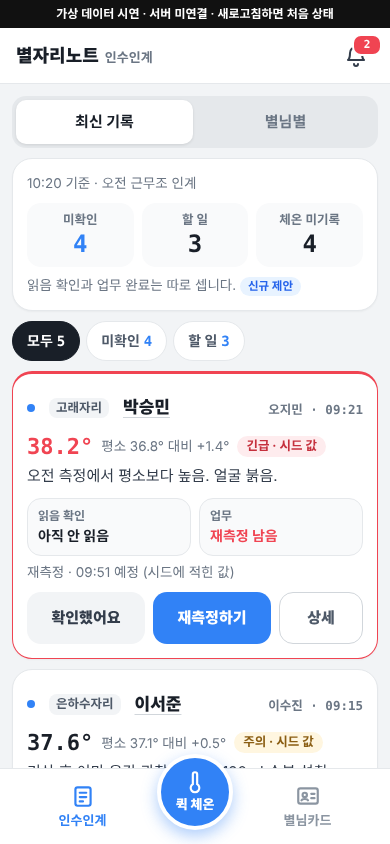
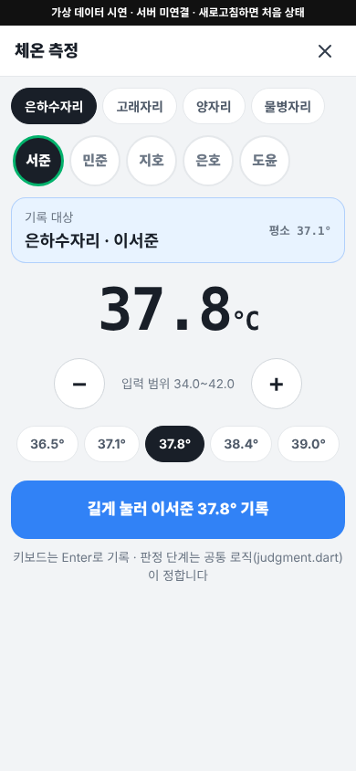
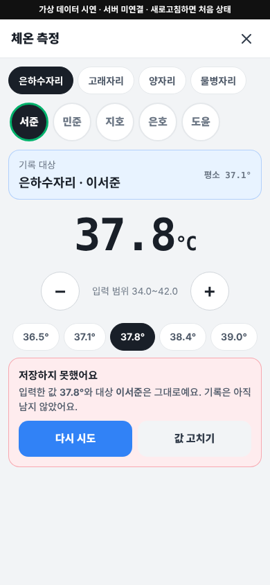
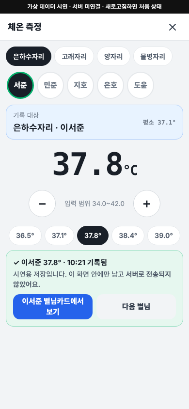
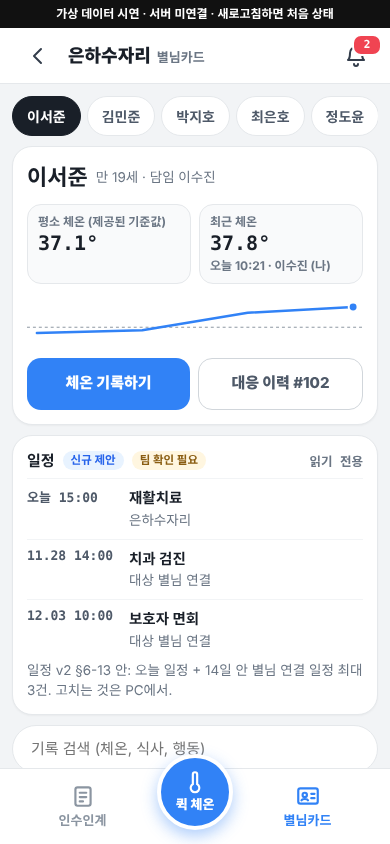
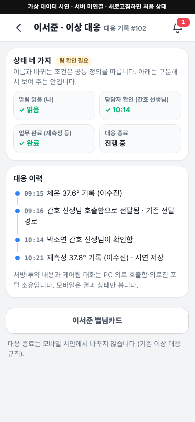

# 별자리노트 — 조별 멘토링 통합본 (2026-11-26)

카카오 테크 포 임팩트 2조 “혜진아왜요쌤”. 울산 혜진원 생활관 선생님이 별님(거주인)의 체온 이상을 기록하면 간호 선생님·의료진·사무국이 같은 기록을 이어서 보는 서비스입니다. 다섯 담당의 화면 시안과 기능명세를 이 폴더에 모았습니다.

> 모든 화면은 **가상 데이터**로 만든 시안·명세입니다. 실제 서버(UNIST 내부망)와의 저장·동기화는 이 묶음에서 확인하지 않았습니다.

## 한눈에 보기

| 파트 | 담당 | 화면 시안 | 명세 |
|---|---|---|---|
| 어플 (생활관 선생님 모바일) | 범수 | [`app/index.html`](app/index.html) | [`APP_기능명세.md`](app/APP_기능명세.md) · [`APP_통합메모.md`](app/APP_통합메모.md) |
| 현황판 (PC) | 진모 | [`board/board.html`](board/board.html) | [`BOARD.md`](board/BOARD.md) |
| 메일함 · 간호 선생님 (PC 03 의료 호출함) | 용태 | 이 묶음에는 없음 | [`PC03_nurse_call_design.md`](nurse-call/PC03_nurse_call_design.md) |
| 메일함 · 의료진 (협진 포털) | 상문 | [`doctor/doctor_portal_design.html`](doctor/doctor_portal_design.html) | [`doctor_portal_spec.md`](doctor/doctor_portal_spec.md) |
| 일정 (PC 캘린더 v2) | 태안 | [`schedule/schedule_prototype_v2.html`](schedule/schedule_prototype_v2.html) | [`schedule_spec_v2.md`](schedule/schedule_spec_v2.md) |

전체를 한 화면에서 보려면 [`index.html`](index.html)을 엽니다. (GitHub 웹에서는 HTML이 코드로 보입니다. 내려받아 더블클릭하거나 아래 “눌러 볼 수 있는 주소 만들기”를 따르세요.)

## 한 건의 체온이 흘러가는 길

`① 어플: 체온 기록` → `② 현황판: 시설 전체 상태` → `③ 간호 선생님 호출함: 확인·대화` → `④ 의료진 포털: 진단·처방` → `⑤ 일정: 재측정·진료를 달력에서 읽기`

## 모바일 시안 (어플 · 범수)

| 인수인계 | 퀵 체온 | 저장 실패 | 저장 성공 | 별님카드 | 대응 기록 |
|---|---|---|---|---|---|
|  |  |  |  |  |  |

이번에 다듬은 세 가지:

1. **저장 상태** — 저장 중에는 다시 누를 수 없고, 실패하면 입력값을 그대로 두고 다시 시도합니다. 서버 응답 전에는 “전송 완료”라고 쓰지 않습니다.
2. **별님별 기록 연결** — 인수인계·저장 결과·알림 어디서든 같은 별님의 카드와 대응 기록으로 이어집니다.
3. **읽음 확인과 업무 완료 구분** — 읽었다는 표시와 재측정·조치를 마쳤다는 표시를 따로 보여 줍니다. 열어 본 것만으로는 바뀌지 않습니다.

체온 판정 기준·재측정 간격·투약 규칙은 새로 정하지 않았습니다. 일정은 모바일 달력 없이 별님카드 안 읽기 전용 요약만 제안했습니다(일정 v2 §6-13).

## 확인한 것과 못 한 것

| 항목 | 상태 |
|---|---|
| 모바일 시안 화면 시연 | 확인 — 브라우저에서 핵심 흐름 10가지 자동 클릭 검수 ([통합메모 4장](app/APP_통합메모.md)) |
| 네 PC 파트 시안·명세 | 각 담당 자료를 내용 수정 없이 모음 (파일 이름만 영문으로 바꿈) |
| 모바일 시안의 실제 앱(Flutter) 반영 | 미완료 |
| 서버 저장·화면 간 동기화 | 미확인 (팀 서버는 UNIST 내부망 전용) |
| 휴대폰 설치 | 미완료 |

## 통합 전에 팀이 정할 것

1. 발표·배포 기준 브랜치 — `v1.01`(일정 탭 없음)과 `main`(일정 탭 있음)이 다릅니다.
2. “확인함 / 완료 / 호출 종료”의 뜻과 버튼별로 바뀌는 상태.
3. 구버전 앱 저장 시 새 일정 항목이 사라질 수 있는 문제 (일정 v2 §7-5).
4. 별님카드에 일정을 어디까지 보여 줄지.
5. 호출함의 “긴급” 표시와 현황판의 위험 건 이름.

## 실행 중인 버전

- 코드: <https://github.com/KimBeomsu01/byeoljari-note> (`main`, `v1.01`)
- 공개 시연판(`main`): <https://kimbeomsu01.github.io/byeoljari-note/>
- 기능 추가본(팀 서버): `http://10.14.11.221:8093/pc`, `http://10.14.11.221:8093/doctor` — UNIST 네트워크 안에서만 열립니다. 시연 계정은 발표자가 안내합니다(공개 저장소에 비밀번호를 적지 않습니다).

## 눌러 볼 수 있는 주소 만들기 (선택)

- **가장 간단:** 이 폴더를 저장소에 `docs/mentoring-1126/`로 올리면 이 README·명세·캡처가 GitHub 웹에서 바로 보입니다.
- **HTML까지 눌러 보려면:** 폴더를 `web/mentoring/`에 넣어 `main`에 올리면, 기존 Pages 배포(`.github/workflows/pages.yml`)가 `web/` 안의 파일을 함께 올려 `https://kimbeomsu01.github.io/byeoljari-note/mentoring/`에서 열릴 것으로 예상합니다. **이 방법은 실제로 배포해 확인하지 않았습니다.** 배포 전에 팀과 상의하세요(`main`에 올리면 공개 시연판이 다시 빌드됩니다).

## 원본 파일 이름

| 이 폴더 | 원본 |
|---|---|
| `schedule/schedule_spec_v2.md`, `schedule_prototype_v2.html` | 별자리노트_일정_전달용_v2.zip의 `별자리노트_일정_기능명세_v2.md`, `별자리노트_일정_화면시제품_v2.html` |
| `nurse-call/PC03_nurse_call_design.md` | `PC03-의료호출함-design.md` |
| `board/BOARD.md`, `board.html` | 현황판.zip의 `BOARD.md`, `현황판.html` |
| `doctor/…` | 의료진메일함.zip의 `doctor_portal_spec.md`, `doctor_portal_design.html` |
| `app/ref/…` | stitch_ui 초안.zip 앱 폴더의 `_1`, `toss_style`, `toss_light_style` 화면 PNG (축소본) |

실제 별님·직원 정보, `.env`, 비밀번호는 들어 있지 않습니다.
