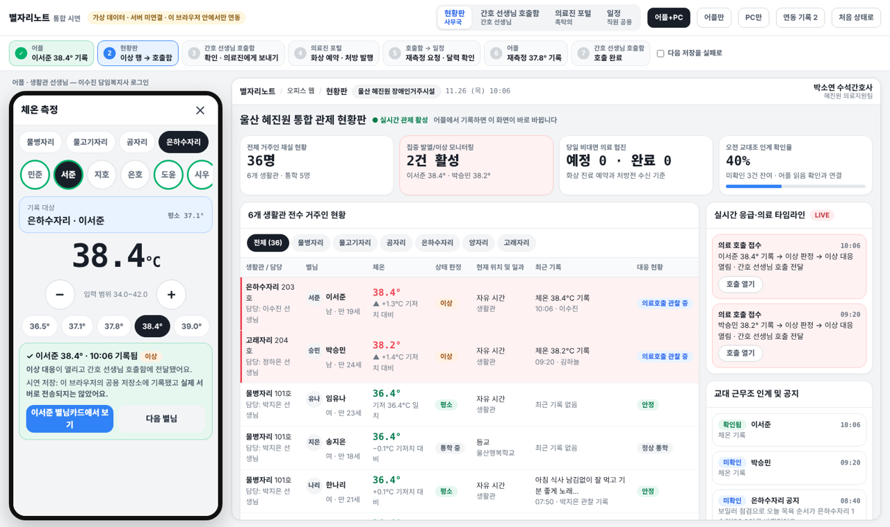
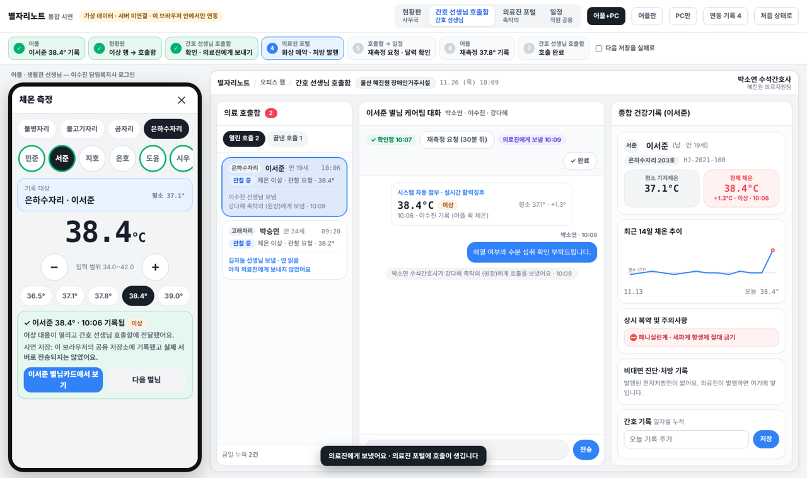
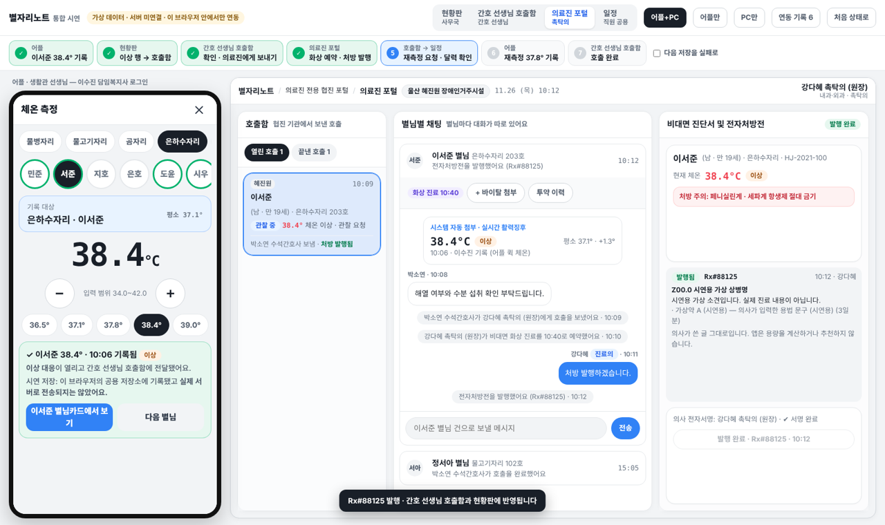
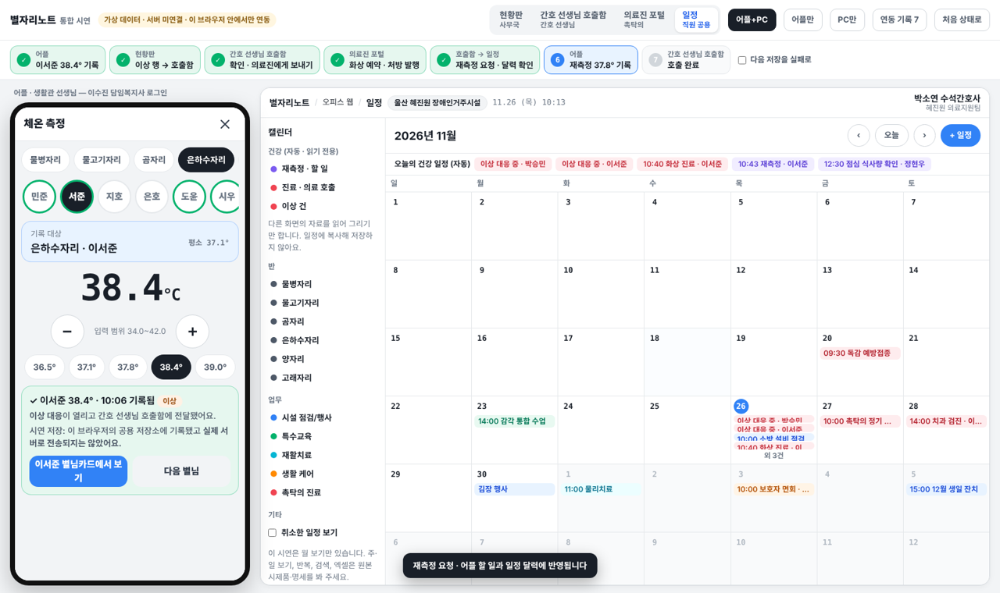

# 별자리노트 — 조별 멘토링 자료 (2026-11-26)

울산 혜진원 생활관 선생님이 별님(거주인)의 체온을 기록하면 간호 선생님·의료진·사무국이 같은 기록을 이어서 보는 서비스입니다. 이 폴더에는 멘토링에서 보여 줄 자료와 팀 문서가 있습니다.

## 무엇을 어디서 보나

| 보여 줄 것 | 어디 | 성격 |
|---|---|---|
| **실제 앱 (서버 연동)** | 팀 서버 `http://10.14.11.221:8093/`(모바일) · `/pc` · `/doctor` — UNIST 네트워크 안에서만 열림 | 저장소 `v1.01` 브랜치의 Flutter 앱. 서버·DB에 저장되고 화면끼리 동기화됨 |
| **통합 시연 앱** | 저장소 `web/mentoring/index.html` → 배포되면 `https://kimbeomsu01.github.io/byeoljari-note/mentoring/index.html` | 다섯 화면이 한 벌의 데이터로 이어지는 흐름을 누구나 눌러 볼 수 있는 웹 시연. 가상 데이터, 서버 미연결, 브라우저 안에만 저장 |
| 공개 시연판 | `https://kimbeomsu01.github.io/byeoljari-note/` | `main` 브랜치의 Flutter 웹(이전 디자인), 기기 안 저장 |

통합 시연 앱은 내려받아 `index.html`을 더블클릭해도 열립니다. 주소 끝에 `#phone`, `#board`, `#calls`, `#doctor`, `#sched`를 붙이면 그 화면만 볼 수 있고, 같은 브라우저의 두 창은 서로 반영됩니다.

## 통합 시연 앱의 2분 순서

1. 어플: [퀵 체온] → 38.4° → 길게 눌러 기록
2. 현황판: 붉게 올라온 이서준 행을 눌러 호출함으로
3. 간호 선생님 호출함: [확인했어요] → [의료진에게 보내기]
4. 의료진 포털: [화상 진료 예약] → 진단서 작성 → 발행
5. 호출함: [재측정 요청] → 일정 달력에서 자동 표시 확인
6. 어플: 🔔 알림 → 대응 기록 → 재측정 37.8°
7. 호출함: [✓ 완료]

| 기록 직후 현황판 | 간호 선생님 호출함 | 의료진 포털 | 일정 |
|---|---|---|---|
|  |  |  |  |

판정 기준과 저장·호출 규칙은 `v1.01` 코드(`judgment.dart`, `repository.dart`)를 그대로 옮긴 것이고, 새로 만든 의료 규칙은 없습니다.

## 이 폴더의 문서

| 문서 | 내용 |
|---|---|
| [`APP_spec.md`](APP_spec.md) | 어플 기능명세 (APP_기능명세) |
| [`APP_integration_memo.md`](APP_integration_memo.md) | 통합메모 (APP_통합메모): 화면 사이 데이터 연결, 팀 확인 필요, 검수 결과 |
| [`APP_real_app_plan.md`](APP_real_app_plan.md) | 실제 앱(v1.01) 반영 작업서: 서버 연동 구조, 고칠 곳, Claude Code용 요청문 |
| [`originals/`](originals/) | 화면별 원본 시안·명세 (현황판, 의료 호출함, 의료진 포털, 일정). 내용 수정 없음 |

## 확인한 것과 못 한 것

| 항목 | 상태 |
|---|---|
| 통합 시연 앱의 7단계 시나리오 | 확인 — Chrome 자동 클릭 46개 항목 통과 |
| 실제 앱(`v1.01`)에 어플 개선 반영 | 미완료 — 작업서만 작성 |
| 팀 서버 저장·동기화 | 미확인 — 이 자료를 만든 환경에서는 접속하지 못함 |
| GitHub Pages로 시연 앱이 열리는지 | 올린 뒤 직접 확인 필요 |

## 브랜치

- `v1.01` — 최신 작업. 서버(`backend/`)와 PC 화면 포함
- `main` — 공개 시연판 배포용 (이전 디자인)

실제 별님·직원 정보, `.env`, 비밀번호는 이 저장소에 올리지 않습니다.
